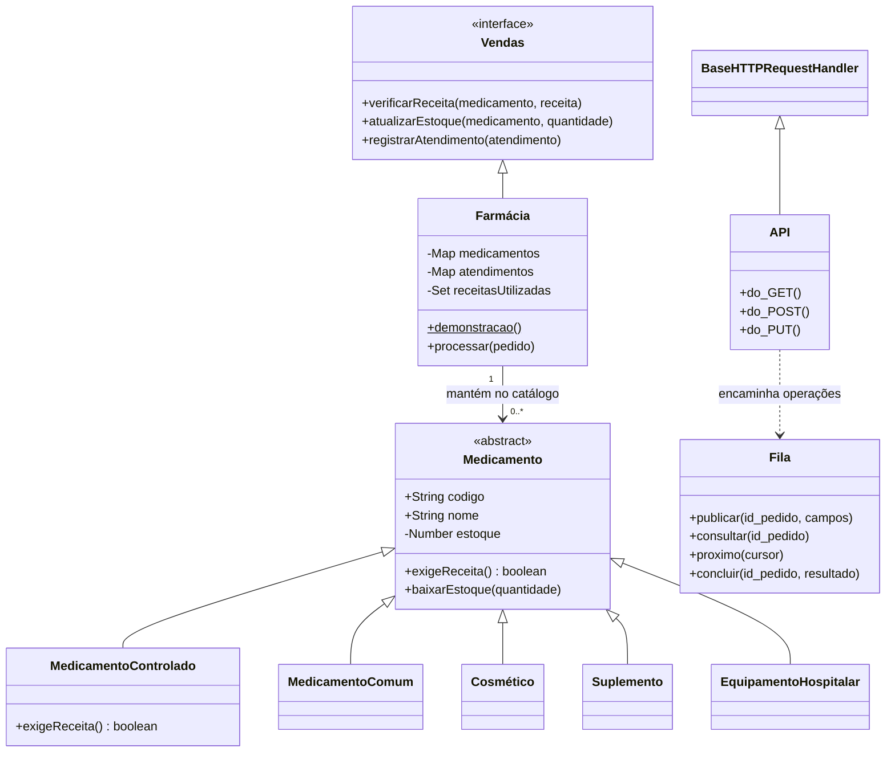

# Trabalho 4 — Sistema de Gestão de Farmácia

- **Equipe 31:** Andressa Colares (471151)
- **Disciplina:** Sistemas Distribuídos — Ciência da Computação, 2026.2

O balcão envia pedidos de venda a uma fila persistente em SQLite. O consumidor em JavaScript valida a receita de demonstração, atualiza o estoque e registra o atendimento. Os pedidos ficam na fila enquanto o consumidor estiver desligado.

[Relatório técnico (PDF)](relatorio-tecnico.pdf)

## Diagrama de classes

O diagrama mostra o catálogo e as vendas no consumidor JavaScript, além das classes da API e da fila persistente no broker Python.



`Vendas` é um contrato representado por uma classe base em JavaScript. O balcão e o consumidor comunicam-se com o broker por HTTP.

## Como executar

Use Python 3.9+ e Node.js 18+. Na pasta `trabalho-4`, inicie o broker:

```sh
python3 broker.py
```

Em outro terminal, envie uma venda com o consumidor desligado. O pedido aparecerá como `pendente`:

```sh
python3 balcao.py venda COM-01 2 --id venda-demo
```

Inicie o consumidor em um terceiro terminal:

```sh
node src/farmacia/consumidor.mjs
```

Consulte o resultado no terminal do balcão:

```sh
python3 balcao.py status venda-demo
```
